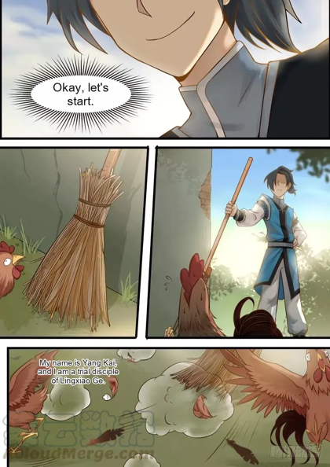

<div align="center">

# Babelink

**Long-form fiction translation that keeps every name, voice and plot thread consistent across the whole book.**

Drop in an EPUB, get back a translated EPUB. Built for translators: review names once, proofread side by side, download and go.

Local-first. Runs on your own models. Nothing leaves your machine unless you point it at a remote endpoint.

[](pyproject.toml)
[](docs/DEVELOPMENT.md)
[](#models)
[-green)](docs/ROADMAP.md)

[Quick start](#-quick-start) · [For translators](#-for-translators-proofread--publish) · [Bare model vs harness](#-why-not-just-call-the-model) · [How it works](#-how-it-works) · [Models](#-models) · [Evaluation](#-evaluation) · [CLI](#-command-line) · [Docs](#-documentation)


</div>

## Why

Sentence-by-sentence machine translation breaks down on long fiction. The heroine's name comes out three ways, a sect becomes a "gate" in
chapter 4 and a "school" in chapter 40, and the register of a dialogue shifts every few lines. Babelink treats a book as one
project with a memory: it remembers how every name was rendered, what happened so far, and what you corrected, and feeds that back into every
later chapter — then proves it with votes, checks and a side-by-side view instead of asking you to trust it.

## ✨ Quick start

```bash
git clone https://github.com/Shashwat1729/babelink
cd babelink
pip install -e ".[web]"              # add `images` for comics, `dev` for the tests
ollama pull hymt2-1.8b              # translation engine (Tencent Hy-MT2, ~3.5GB)
ollama pull huihui_ai/qwen3-abliterated:4b   # helper: names, summaries, review
babelink --project-dir my-books web        # http://127.0.0.1:8000
```

Then: **New work → drop your EPUB → Translate → Download translated EPUB.** The app picks the right engine per language automatically
(CAT-Translate for Japanese→English, Hy-MT2 for the rest — see [Models](#-models)).

Requires Python 3.11+ and [Ollama](https://ollama.com) for local translation. Without a model the app runs in demo mode
(the mock provider copies the text), which is useful for trying the interface.

## 📖 For translators: proofread & publish

Translating a chapter is three clicks. Proofreading it is the actual job, so the UI is built around that:

1. **Translate one chapter or the whole book.** Each chapter row has its own **Translate** button with live progress;
   **Translate remaining** runs the book. The translation streams in paragraph by paragraph — Stop ends the current one.
2. **Review names once.** The Names tab lists every mined name with its proposed rendering — confirm, edit or ignore.
   Your decisions lock in and propagate to every later chapter (paragraphs that used an old rendering are marked outdated).
3. **Proofread side by side.** Each chapter opens as original | translation paragraph pairs with edit, approve,
   retranslate-per-paragraph and a look at exactly what context the model was given (**Context**).
   The **Proofread** button switches to a continuous two-column reading view (original left, translation right,
   quality warnings edge-marked) that prints cleanly for paper review.
4. **Download and go.** **Download translated EPUB** writes the translation back into your original EPUB —
   layout, images and table of contents kept — and warns before exporting an unfinished book.
   Tick *Show the original under each paragraph* for a bilingual edition, or take plain text (.txt).
   Approved paragraphs are never overwritten by later runs.

| Chapter view | Proofread reading view | Phone |
|---|---|---|
|  |  |  |

| Names review | Model picker | Context inspector |
|---|---|---|
|  |  |  |

> Screenshots follow the current UI; the proofread view is the newest addition.

## 📚 What it translates

| Format | Example tested | Engine | Status |
|---|---|---|---|
| Chinese web novel (zh→en) | Red Chamber ch.3 vs Hawkes | Hy-MT2-1.8B | 13/13 terms, Harness 97 |
| Japanese light novel (ja→en) | ParallelFiction bake-off | CAT-Translate-1.4B | beats Hy-MT2 head-to-head |
| Japanese light novel (ja→zh) | OpenSakura, gold glossary | Hy-MT2-1.8B | 9/9 terms vs 1/9 bare |
| Japanese classic (ja→en) | Rashōmon, 32 paras | CAT-Translate-1.4B | 32/32 complete, QA 5→1 |
| Chinese manhua (zh→en) | Martial Peak ch.1 raws, photo above | OCR + Hy-MT2 | 21/21 blocks, QA 21/21, 0 source words left |
| Korean manhwa (en→zh) | Nano Machine ch.1, full strip above | OCR + Hy-MT2 | 21/21 blocks, 62s, QA 21/21 |
| Korean manhwa (ko→en) | Nano Machine | OCR + Hy-MT2 | ko→en engine proven; KO story raws JS-walled |
| Japanese manga (ja→en) | One Piece class | — | blocked on Japanese OCR (no usable open weights; same per-script slot as Korean, ready to fill) |

Direction-aware default (`--provider auto`) picks the engine; every other direction falls back to Hy-MT2,
which also handles ko→en and ja→en (smoke-tested). EPUB in, translated EPUB out for prose; pages in, CBZ out for comics.

## 🥊 Why not just call the model?

A bare translation model on its own is fluent and inconsistent. Measured head-to-head on real books
(Hy-MT2-1.8B, same passages, same model — the only difference is the harness):

| | Bare model call | Babelink harness |
|---|---|---|
| Name/term adherence, OpenSakura ja→zh (9 gold terms) | 1/9 | **9/9** |
| Name/term adherence, Red Chamber ch.3 (13 glossary terms) | 2/4 (early code) | **13/13** |
| Harness Score (terms applied · complete delivery · QA-clean · nothing refused) | 80 | **97** |
| QA warnings, Rashomon 32-paragraph run | 5 | **1** (both 32/32 complete, zero untranslated text left) |
| Fluency (chrF vs human reference) | — | within ±2 (see note) |

Note: chrF against published human translations barely moves — those references are free literary rewrites
(Victorian-era Hawkes, fan prose), and no orchestration makes a 1.8B model write like them. The harness wins
everything a novel actually needs: the same name rendered the same way in chapter 1 and chapter 80,
nothing skipped, nothing refused, everything checked. Fluency comes from the engine (see [Models](#-models));
fidelity comes from the harness.

**What the harness does that a bare call cannot:**

- 🔒 **Names that stay put** — mined once, confirmed by you, enforced in every later chapter; the book itself
  votes on the final surface and losing variants are rewritten deterministically.
- 🗳️ **Elections, not guesses** — when sources disagree on a rendering, shipped outputs elect the winner by majority.
- 🗣️ **Phonetic authorities** — vendored Unihan reading tables reject misread names (黛玉="Da Yu", 松本="Matsubara")
  before they can ever enforce, in Chinese and Japanese.
- 🧩 **Piecewise long paragraphs** — long paragraphs translate as sentence pieces sharing one glossary context
  (+1.2 chrF on the benchmark, and faster).
- 🛡️ **Delivery guarantees** — retries, refusal handling, provider failover chains, deterministic QA
  (missing text, prompt leaks, leftover source language, number mismatches, terms not applied), contradiction
  detection across chapters.
- 📚 **Project memory** — chapter summaries, story bible, translation memory: earlier lines and events feed every
  later paragraph, and your edits are remembered for similar lines.

## ⚙️ How it works

```
EPUB / TXT / pasted text / comic pages (OCR)
   -> chapters -> segments (paragraphs, or speech bubbles)
   -> term mining (burstiness statistics, no word lists)
   -> helper classifies + translates names -> translator-agreement gate -> you confirm
   -> context per segment: agreed names, summaries, previous passages, translation memory
   -> translation (piecewise for long paragraphs, placeholders for names on narrow engines)
   -> book election + deterministic normalization -> QA (+ optional AI review)
   -> your edits and approvals
   -> translated EPUB / TXT (bilingual optional), or re-lettered pages (PNG / CBZ)
```

Everything lives in one SQLite file plus editable JSON Story Bible files (`project.db`, `projects/<id>/story_bible/*.json`).
Segments move through `UNPROCESSED → ANALYZED → TRANSLATED → REFINED → QA_PASSED / NEEDS_REVIEW / HUMAN_APPROVED`,
and `STALE` when a name they use changes. Design notes: [docs/ARCHITECTURE.md](docs/ARCHITECTURE.md),
[docs/DECISIONS.md](docs/DECISIONS.md). Every experiment and its result: [docs/EXPERIMENTS.md](docs/EXPERIMENTS.md).

## 🤖 Models

Small, specialized, local. The app picks the engine per direction automatically (`--provider auto`, the default):

| Direction | Engine | Size | Why |
|---|---|---|---|
| ja → en | CAT-Translate-1.4B (Ollama `cat14b`) | ~1.9GB | Beats Hy-MT2 head-to-head on fiction ja→en |
| zh → en, others | Hy-MT2-1.8B (Ollama `hymt2-1.8b`) | ~3.5GB | Translation-only model from Tencent; official chat template bundled |
| Helper (all) | `huihui_ai/qwen3-abliterated:4b` | ~2.5GB | Names, summaries, review — never translation itself |

```bash
ollama pull hymt2-1.8b
ollama pull huihui_ai/qwen3-abliterated:4b
# Japanese novels: build the CAT model from its GGUF (see docs/MODELS.md)
```

## 📊 Evaluation

Measured against human translations with chrF and term adherence, plus the Harness Score (terms applied,
complete delivery, QA-clean, nothing refused) that tracks what the harness controls:

- **OpenSakura** ja→zh, gold glossary: **9/9 terms vs 1/9 bare** — terminology that actually counts.
- **Red Chamber** zh→en ch.3 vs Hawkes: **13/13 terms, Harness 97**, chrF 41.8 → 43.0 with piecewise.
- **ParallelFiction** ja→en bake-off: CAT-Translate wins the engine choice; harness matches bare fluency ±2.
- **Rashomon** ja→en long-form (32 paragraphs): 32/32 complete both legs, QA warnings 5 → 1.
- **Full book**: 1,648 chapters / 81,798 segments audited with 0 tag/segment issues; exported EPUB validates.
- 128 offline tests, every bug a regression test plus a row in [docs/REGRESSIONS.md](docs/REGRESSIONS.md).

Numbers, method and honest limits: [docs/EVALUATION.md](docs/EVALUATION.md). Corpora and what's next:
[docs/DATASETS.md](docs/DATASETS.md). What is not built: [docs/GAPS.md](docs/GAPS.md).

## 💻 Command line

```bash
babelink --project-dir demo import novel.epub --source-lang zh
babelink --project-dir demo analyze 1 --provider auto        # mine names, propose renderings
babelink --project-dir demo terminology 1 --accept-all
babelink --project-dir demo translate 1 --provider auto
babelink --project-dir demo qa 1
babelink --project-dir demo export 1 --out translated.epub
babelink --project-dir demo validate 1 --file translated.epub
```

Continue a book chapter by chapter:

```bash
babelink --project-dir demo paste 1 --file chapter12.txt --title "Chapter 12" --translate --provider auto
cat chapter13.txt | babelink --project-dir demo paste 1 --translate --provider auto
```

One chapter out as text: `babelink --project-dir demo export 1 --out chapter.txt` (add `--bilingual` for original + translation; `.epub`/`.cbz` pick their writer from the extension).
Score a run against a human translation: `babelink eval-epub original.epub human.epub --chapters 3 --configs ADF`.

Other commands: `projects`, `chapters`, `terminology`, `edit`, `approve`, `retranslate --term X --new Y`, `review`,
`storybible`, `style`, `models`, `refine`, `benchmark`, `eval-epub`, `datasets`.

### Configuration

`<project-dir>/babelink.yaml` or `--config FILE`; command-line flags win over the file, and unknown keys are rejected.

```yaml
provider: auto
model: ""            # empty = direction-aware default engine (CAT for ja->en, Hy-MT2 otherwise)
target_lang: en
style: literary                    # literal | faithful-natural | literary | highly-literary
n_prev: 4                           # earlier translated passages shown to the model
```

## 📚 Documentation

| | |
|---|---|
| [EXPERIMENTS](docs/EXPERIMENTS.md) | Every hypothesis, result and failed approach (E01–E17) |
| [ARCHITECTURE](docs/ARCHITECTURE.md) | Components, data flow, the comic-page pipeline |
| [DECISIONS](docs/DECISIONS.md) | Design decisions and why |
| [EVALUATION](docs/EVALUATION.md) | Results, method, caveats |
| [DATASETS](docs/DATASETS.md) | Corpora used and the next ones to add, with licences |
| [GAPS](docs/GAPS.md) | What is not built and where the evidence is thin |
| [ROADMAP](docs/ROADMAP.md) | What is done and what is next |
| [MODELS](docs/MODELS.md) | Model registry and recommendations |
| [REGRESSIONS](docs/REGRESSIONS.md) | Every bug found and the test that guards it |
| [DEVELOPMENT](docs/DEVELOPMENT.md) | Setup, layout, checks |

## Manhua and comics

Real pages through the real loop — raw left, ours right (downscaled; Nano Machine art © Hanjung Worya /
Geumgang Bulgoe, Martial Peak art © 噼咔噼 / Tencent).

**Martial Peak ch.1, Chinese → English** (raws fetched from a Chinese aggregator, AES-descrypted with the key
from its own reader JS):

| Raw page | Our translation |
|---|---|
|  |  |

4 pages, 11/11 blocks OCR'd, 11/11 translated in 37s, QA 11 checked / 11 passed / 0 warnings —
and again on the dialogue pages (pp.6+11): 10/10 translated, QA 10/10, zero source words left anywhere:

| Bubble (p.11) | Ours | QA |
|---|---|---|
| 这就是那个试炼弟子杨开啊 | This is the trial disciple Yang Kai. | — |
| 到现在还是淬体三层 | Still at the third level of Body Tempering. | — |
| 上次他被挑战已经过了五天了… | It has been five days since he was challenged last time. | — |
| 又有挑战他的机会了！ | Now there's a chance to challenge him! | — |
| 这么多人，有些过分了吧？ | So many people—isn't that a bit excessive? | — |

A same-panel fan-English third column was pursued and blocked: MangaDex hosts no Martial Peak,
Trash Scanlations gates behind ads/SSL, zinmanga bot-walls (fetch log in [docs/DATASETS.md](docs/DATASETS.md)) —
so the pairs above stand as raw vs ours, with the QA table as the referee instead of a second human.

**Nano Machine ch.1, English → Chinese** (full webtoon strip, Asura Scans English):

| Raw strip | Our translation |
|---|---|
|  |  |

4 pages, 21/21 blocks in 62s, QA 21 checked / 21 passed / 5 warnings / 0 needs review.

**Translator's notes — auto-generated per bubble** (Nano Machine run; this is what the proofreader sees):

| Bubble | Ours | QA |
|---|---|---|
| I CAN'T MOVE...MYLEG ANYMORE...! | 我无法移动……我的腿已经不行了……！ | — |
| DAMN IT ALL... | 该死！！ | echo-dump caught → stripped → re-ran clean |
| YOU MUST'VE HAD QUITE A LOT OF TROUBLE RUNNING FOR AN HOUR TO R... | 你肯定花了好长时间，跑了一个小时才走到这里。 | truncated_ending (source bubble itself cut) |
| WELL DONE, PRINCE CHEON. | 干得好，车恩王子。 | — |
| THAT I'VE BEEN DANCING IN THE MIDDLE OF YOUR PALMS FROM THE START... | 那泰维本正在从开始阶段在你的手掌中间跳舞…… | — |

Korean pages use a Korean recognition model (official PP-OCR weights, no new packages); Japanese pages still
need another recognizer, and Korean story raws are still behind JS walls (covers fetched — fetch log in
[docs/DATASETS.md](docs/DATASETS.md)).

```bash
pip install -e ".[web,images]"
babelink --project-dir demo import page.png --name "Demo" --source-lang zh --target-lang en
babelink --project-dir demo translate 1 --provider auto
babelink --project-dir demo export 1 --out translated.cbz
```

**Limits to know about.** The bundled OCR reads Chinese, English and Korean (Korean via external weights);
Japanese needs another recogniser. Vertical text, right-to-left reading order and model-based inpainting are
not built. Text on busy art leaves smudges. Details in [docs/GAPS.md](docs/GAPS.md).

The server only accepts loopback `Host` headers (add others with
`BABELINK_HOSTS`) and requires an `X-Requested-With` header on every write. It has no accounts or TLS, so do not expose it to a network.
Theme (system, light, dark) and accent colour are under the circle icon.

## Development

```bash
pip install -e ".[web,images,dev]"
python -m pytest -q                                      # 128 tests; no network or model needed
python scripts/ui_smoke.py --url http://127.0.0.1:8765   # novel flow in a real browser (needs playwright)
python scripts/ui_pages_smoke.py --url http://127.0.0.1:8765   # comic-page flow in a real browser
python scripts/ui_live_smoke.py --url http://127.0.0.1:8765    # live streaming, Stop, double click (needs a running Ollama model)
```

Source layout:

```
src/babelink/   pipeline, context, terminology, story bible, qa, refinement, importers, exporters, providers,
                  images (comic pages), web + static UI, evaluation
tests/            pytest suite
scripts/          corpus download, held-out evaluation, browser smoke tests, sample page generator
docs/             architecture, decisions, evaluation, datasets, gaps, roadmap
```

## License

Proprietary — evaluation use only, see [LICENSE](LICENSE). Commercial use needs a licence from the
copyright holder. Shipped demo crops are downscaled fragments for illustration; full evaluation
texts and comic pages stay local and are never committed.

Evaluation texts are public-domain Project Gutenberg files fetched on demand, or copyrighted chapters kept locally and never committed. Comic-page OCR uses
[RapidOCR](https://github.com/RapidAI/RapidOCR) (Apache-2.0). Reference projects were studied; no code was copied from them.
