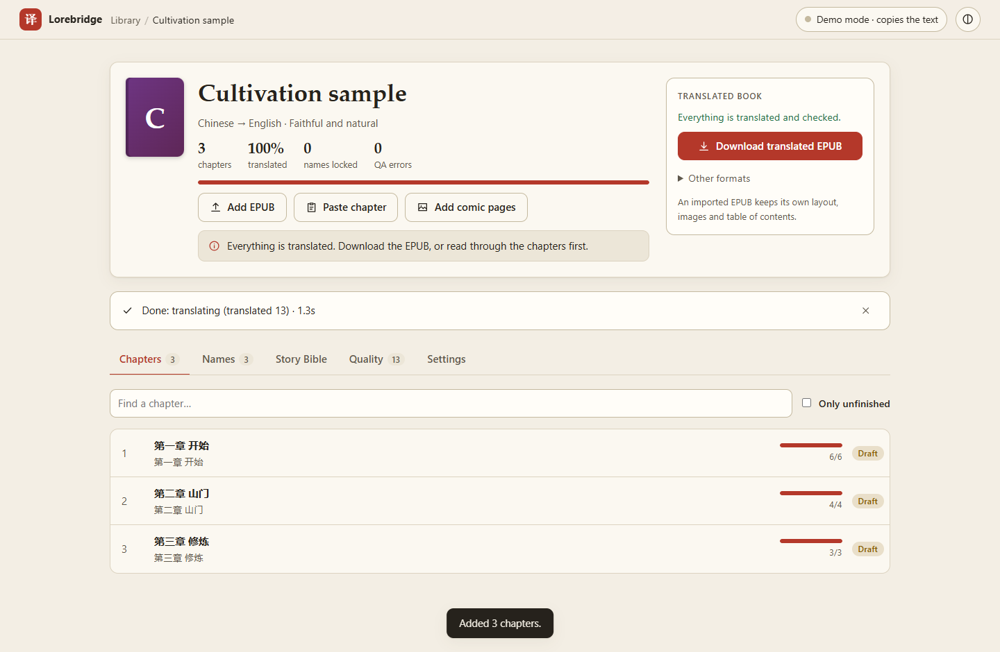
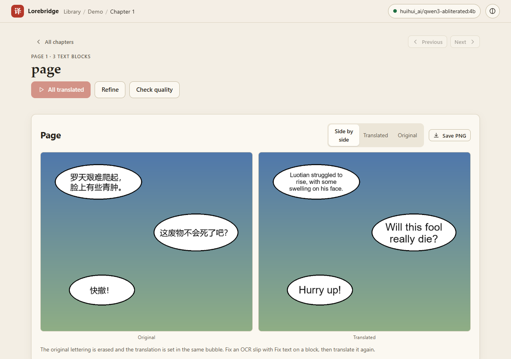
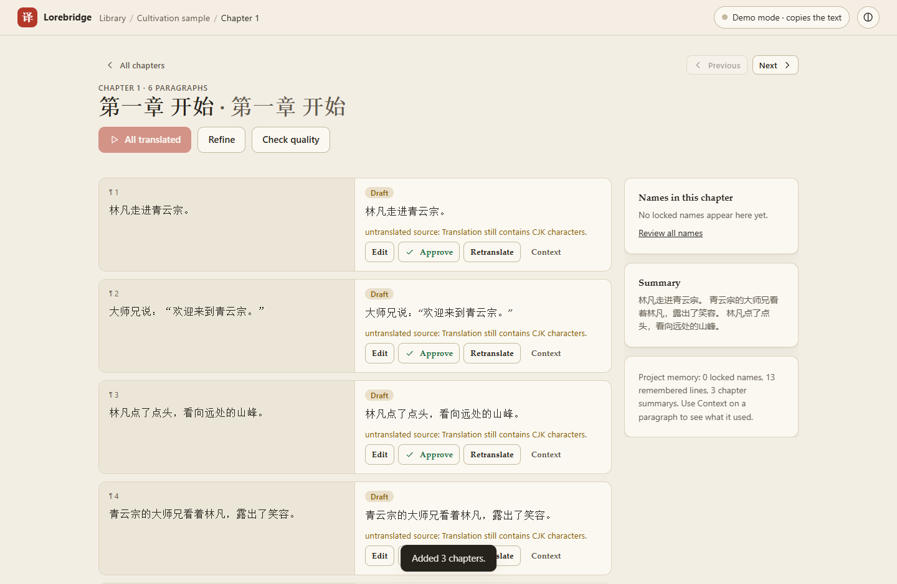
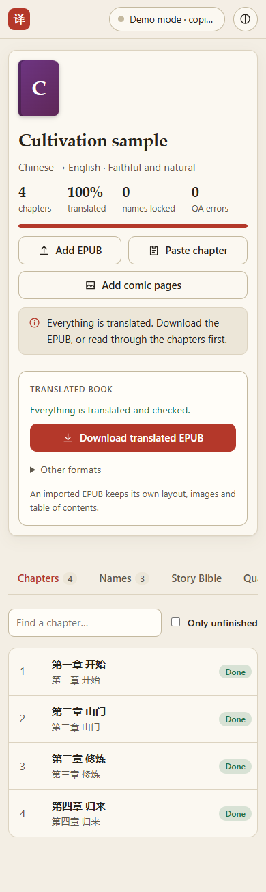
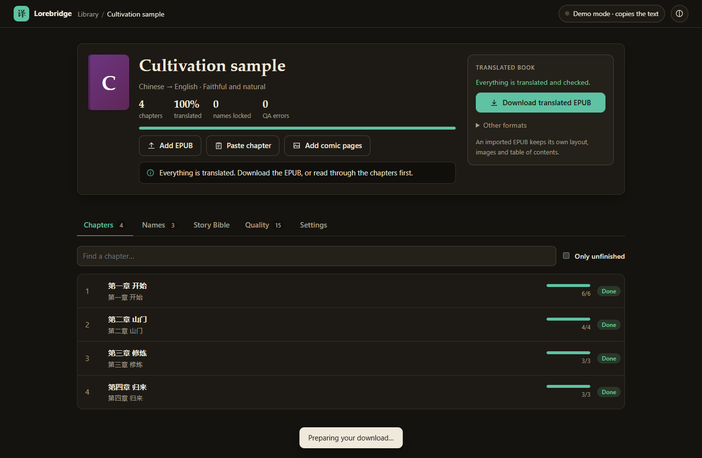
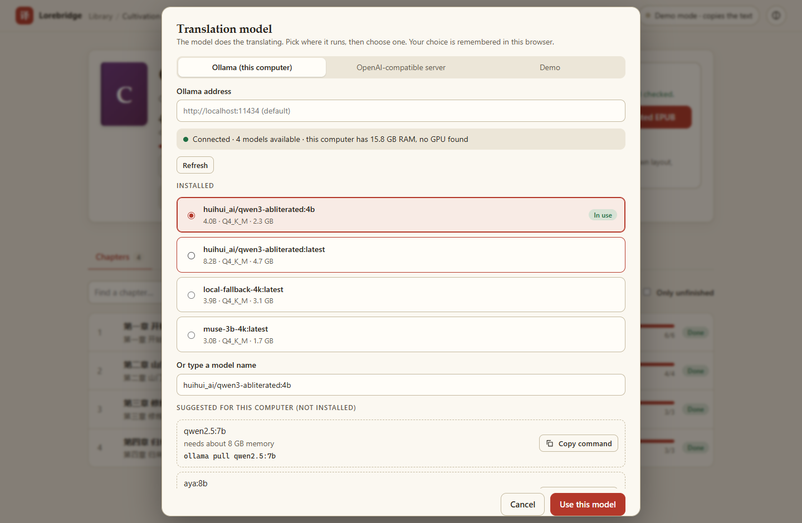
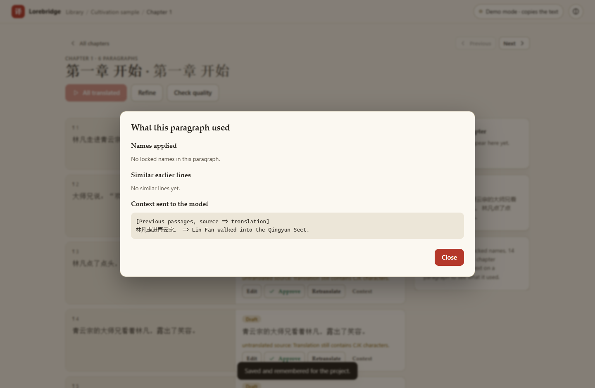

<div align="center">

# Lorebridge

**Translate web novels, EPUBs and manhua with one memory of names, tone and plot across every chapter.**

Local-first. Runs on your own models. Paste the next chapter, or drop in a comic page, and it picks up where the last one stopped.

[](pyproject.toml)
[](docs/DEVELOPMENT.md)
[](#models)
[-orange)](docs/ROADMAP.md)

[Quick start](#quick-start) · [Comics](#manhua-and-comics) · [Web app](#web-app) · [CLI](#command-line) · [How it works](#how-it-works) · [Evaluation](#evaluation) · [Docs](#documentation)



</div>

## Why

Sentence-by-sentence machine translation breaks down on long fiction. The hero's name comes out three ways, a sect becomes a "gate" in
chapter 4 and a "school" in chapter 40, and the register of a dialogue shifts every few lines. Lorebridge treats a book as one
project with a memory: it remembers how every name was rendered, what happened so far, and what you corrected, and feeds that back into every
later chapter, whether the chapter arrives as an EPUB, as pasted text or as a comic page.

## What it does

| | |
|---|---|
| **Novels and EPUBs** | Add an EPUB and every chapter appears. Translate one chapter or the whole book, then download a translated EPUB that keeps your original layout, images and table of contents. |
| **See it as it is written** | The translation streams into the page word by word, finished paragraphs stay on screen while the next one is written, and you can translate in batches (about 2,000 characters or 1,000 words at a time) so you can read and fix a batch before going on. Stop ends the paragraph being written. |
| **Chapter-by-chapter paste** | Paste the next chapter when it comes out. Names, earlier summaries and the last translated passages carry over automatically. |
| **Manhua, manga and webtoons** | Add page images or a CBZ, or paste an image from the clipboard. OCR reads the exact text and where it sits, the translation goes through the same memory, and the page comes back with the lettering replaced. |
| **Names that stay put** | Mined names and terms are translated once, you confirm or edit them, and every later chapter uses them. Change one and the paragraphs that used it are marked outdated. |
| **Human in the loop** | Edit, approve (approved text is never overwritten), retranslate one paragraph, fix an OCR slip, and see exactly what context the model was given. |
| **Quality checks** | Missing translations, prompt leaks, untranslated source, number mismatches, terms not applied; optional AI review. |
| **Your models** | Ollama, any OpenAI-compatible endpoint, a hardware-aware model picker, a separate refinement model, escalation for hard passages. Nothing leaves your machine unless you point it at a remote endpoint. |

## Manhua and comics



| Original | Translated |
|---|---|
|  |  |

*Generated demo page, translated by a local 4B model through the CLI. The model rendered the last bubble (`快撤！`, "Retreat!") as "Hurry up!". Checking the text is still your job.*

1. **Read.** RapidOCR finds each line of text and its position. Tall webtoon strips are cut into overlapping tiles first. Lines are grouped into
   speech bubbles and put in reading order.
2. **Translate.** Each bubble is a segment in the normal pipeline, so names, memory and context work exactly as they do for a novel.
3. **Replace.** The old lettering is erased (filled with the bubble's own colour, or inpainted when it sits on artwork) and the translation is
   set in the same bubble, with the font size fitted to the space.
4. **Correct and export.** Fix what the OCR misread, compare original and translated side by side, save a page as PNG or download everything as a CBZ.

```bash
pip install -e ".[web,images]"
lorebridge --project-dir demo import page.png --name "Demo" --source-lang zh --target-lang en
lorebridge --project-dir demo translate 1 --provider ollama --model huihui_ai/qwen3-abliterated:4b
lorebridge --project-dir demo export 1 --out translated.cbz
```

**Limits to know about.** The bundled OCR reads Chinese and English; Japanese and Korean need another recogniser. Vertical text, right-to-left
reading order, sound effects and model-based inpainting are not built. Text on busy art leaves smudges. It has been tested on generated pages and in a
browser, and has not been scored on a manga benchmark. Details in [docs/GAPS.md](docs/GAPS.md).

## Quick start

```bash
git clone https://github.com/Shashwat1729/lorebridge
cd lorebridge
pip install -e ".[web,images]"        # drop `images` if you only translate text; add `dev` for the tests
ollama pull huihui_ai/qwen3-abliterated:4b
lorebridge --project-dir my-books web  # http://127.0.0.1:8000
```

Requires Python 3.11+ and, for local translation, [Ollama](https://ollama.com). The app works without a model in demo mode (the mock provider copies the text), which is useful for trying the interface.

### Web app

Create a **work** (one per novel or series), drop its EPUB on it, and the chapters are listed. **Translate remaining** runs the whole book, or pick a batch size next to it to translate a limited amount per run (CLI: `translate 1 --words 2000`). **Download translated EPUB** writes it back into your original EPUB and warns before you export an unfinished book.
**Paste chapter** adds the next one and shows what is carried over. Tabs per work: Chapters, Names, Story Bible, Quality, Settings.

The model chip in the header lists installed models, suggests ones that fit your RAM and GPU with a copyable `ollama pull`, and has a Test button.
Theme (system, light, dark) and accent colour are under the circle icon. The server only accepts loopback `Host` headers (add others with
`LOREBRIDGE_HOSTS`) and requires an `X-Requested-With` header on every write. It has no accounts or TLS, so do not expose it to a network.

| Chapter view | Page view | Phone |
|---|---|---|
|  |  |  |

| Dark, jade accent | Model picker | Context inspector |
|---|---|---|
|  |  |  |

### Command line

```bash
lorebridge --project-dir demo import novel.epub --source-lang zh
lorebridge --project-dir demo analyze 1 --provider ollama --suggest     # mine names, propose renderings
lorebridge --project-dir demo terminology 1 --accept-all
lorebridge --project-dir demo translate 1 --provider ollama --model huihui_ai/qwen3-abliterated:4b
lorebridge --project-dir demo qa 1
lorebridge --project-dir demo refine 1 --provider ollama
lorebridge --project-dir demo export 1 --out translated.epub
lorebridge --project-dir demo validate 1 --file translated.epub
```

Continue a book chapter by chapter:

```bash
lorebridge --project-dir demo paste 1 --file chapter12.txt --title "Chapter 12" --translate --provider ollama
cat chapter13.txt | lorebridge --project-dir demo paste 1 --translate --provider ollama
```

Other commands: `projects`, `chapters`, `terminology`, `edit`, `approve`, `retranslate --term X --new Y`, `review`, `storybible`, `style`, `models`,
`benchmark`, `benchmark-run`, `matrix`, `eval-epub`, `datasets`.

### Configuration

`<project-dir>/lorebridge.yaml` or `--config FILE`; command-line flags win over the file, and unknown keys are rejected.

```yaml
provider: ollama
model: huihui_ai/qwen3-abliterated:4b
models: {refine: qwen2.5:14b}     # per task: analyze translate refine review paste retranslate terminology
target_lang: en
style: literary                    # literal | faithful-natural | literary | highly-literary
n_prev: 4                          # earlier translated passages shown to the model
```

### Models

Any model Ollama serves, or any OpenAI-compatible endpoint. Qwen3-family models are called with thinking disabled. A 4B model runs on a laptop CPU
but is slow (a paragraph takes seconds) and makes real mistakes; a larger model is the single biggest quality lever. The registry and the picker
([docs/MODELS.md](docs/MODELS.md)) recommend models for your hardware.

## How it works

```
EPUB / TXT / HTML / pasted text / comic pages (OCR)
   -> chapters -> segments (paragraphs, or speech bubbles)
   -> term mining -> names you confirm -> Story Bible + chapter summaries
   -> context for each segment: names present, summaries, previous passages, translation memory
   -> translation -> guarded literary refinement -> deterministic QA (+ AI review)
   -> your edits and approvals
   -> translated EPUB / TXT, or pages with the lettering replaced (PNG / CBZ)
```

Everything lives in one SQLite file plus editable JSON Story Bible files (`project.db`, `projects/<id>/story_bible/*.json`). Segments move through
`UNPROCESSED → ANALYZED → TRANSLATED → REFINED → QA_PASSED / NEEDS_REVIEW / HUMAN_APPROVED`, and `STALE` when a name they use changes.
Design notes: [docs/ARCHITECTURE.md](docs/ARCHITECTURE.md), [docs/DECISIONS.md](docs/DECISIONS.md).

## Evaluation

Measured against human translations with chrF++ and term adherence, on a held-out web novel and a public-domain book, using a 4B local model.

- The glossary does its job: agreed names and terms appear in the output in 7 to 12 of 12 cases, against 1 to 8 of 12 for the bare model.
- Overall chrF is **within noise** (about ±1) of the bare model on 12 to 14 paragraph excerpts. No claim that the full pipeline translates better is made until runs with
  whole chapters and a larger model say so.
- Testing on unseen data found a real bug (ordinary words entering the glossary), now fixed with a regression test.

Numbers, method and limits: [docs/EVALUATION.md](docs/EVALUATION.md). More datasets to test against, with licences:
[docs/DATASETS.md](docs/DATASETS.md).

## Documentation

| | |
|---|---|
| [ARCHITECTURE](docs/ARCHITECTURE.md) | Components, data flow, the comic-page pipeline |
| [DECISIONS](docs/DECISIONS.md) | Design decisions and why |
| [EVALUATION](docs/EVALUATION.md) | Results, method, caveats |
| [DATASETS](docs/DATASETS.md) | Corpora used and the next ones to add, with licences |
| [GAPS](docs/GAPS.md) | What is not built and where the evidence is thin |
| [ROADMAP](docs/ROADMAP.md) | What is done and what is next |
| [MODELS](docs/MODELS.md) | Model registry and recommendations |
| [REGRESSIONS](docs/REGRESSIONS.md) | Every bug found and the test that guards it |
| [DEVELOPMENT](docs/DEVELOPMENT.md) | Setup, layout, checks |

## Development

```bash
pip install -e ".[web,images,dev]"
python -m pytest -q                                      # 82 tests; no network or model needed
python scripts/ui_smoke.py --url http://127.0.0.1:8765   # novel flow in a real browser (needs playwright)
python scripts/ui_pages_smoke.py --url http://127.0.0.1:8765   # comic-page flow in a real browser
python scripts/ui_live_smoke.py --url http://127.0.0.1:8765    # live streaming, Stop, double click (needs a running Ollama model)
```

Every bug becomes a regression test and a row in [docs/REGRESSIONS.md](docs/REGRESSIONS.md). Source layout:

```
src/lorebridge/   pipeline, context, terminology, story bible, qa, refinement, importers, exporters, providers,
                  images (comic pages), web + static UI, evaluation
tests/            pytest suite
scripts/          corpus download, held-out evaluation, browser smoke tests, sample page generator
docs/             architecture, decisions, evaluation, datasets, gaps, roadmap
```

## License

No licence has been chosen yet, so all rights are reserved by default. Add a `LICENSE` file before sharing the code.

Evaluation texts are public-domain Project Gutenberg files fetched on demand, or copyrighted chapters kept locally and never committed. Comic-page OCR uses
[RapidOCR](https://github.com/RapidAI/RapidOCR) (Apache-2.0). Reference projects were studied; no code was copied from them.
